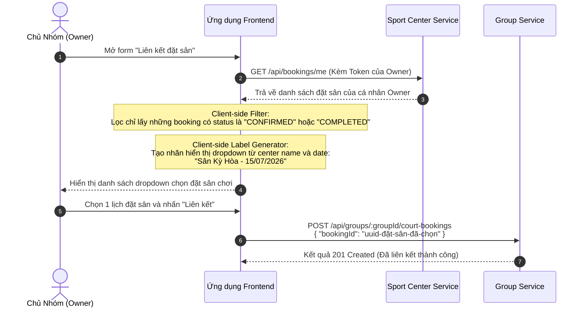

# Hướng dẫn Tích hợp Frontend: Dịch vụ Nhóm (Group Service)

Tài liệu này cung cấp chỉ dẫn tích hợp API chi tiết dành cho các lập trình viên Frontend (React, React Native, Vue, v.v.) khi làm việc với **Group Service** (`group-service`). Hướng dẫn bao gồm cách cấu hình Header, xử lý UX trạng thái tải (Loading), thiết lập các form phức tạp, tích hợp đặt sân chéo dịch vụ và ánh xạ mã lỗi sang tiếng Việt.

---

## 🔒 1. Cơ chế Xác thực & Gửi Access Token

Hầu hết các API công khai của dịch vụ đều nằm sau lớp bảo vệ xác thực JWT. Frontend bắt buộc phải lưu trữ token đăng nhập (ở `localStorage` hoặc `SecureStore`) và đính kèm vào Header của mọi request.

*   **Định dạng Header**: `Authorization: Bearer <JWT_ACCESS_TOKEN>`
*   **Port mặc định của dịch vụ ở Local**: `4002` (hoặc thông qua API Gateway của hệ thống).

### Cấu hình Axios Interceptor (Ví dụ mẫu):
```typescript
import axios from 'axios';

const groupApi = axios.create({
  baseURL: process.env.GROUP_SERVICE_URL || 'http://localhost:4002',
  headers: {
    'Content-Type': 'application/json',
  },
});

// Tự động đính kèm token vào mọi request
groupApi.interceptors.request.use((config) => {
  const token = localStorage.getItem('accessToken'); // Hoặc AsyncStorage.getItem
  if (token) {
    config.headers.Authorization = `Bearer ${token}`;
  }
  return config;
}, (error) => {
  return Promise.reject(error);
});
```

---

## 👤 2. Quản lý Nhóm & Thành viên (Group & Members)

### A. Đăng ký/Tạo nhóm mới
*   **API**: `POST /api/groups`
*   **Payload gửi lên (Request Body)**:
    ```json
    {
      "name": "Sunrise Pickleball Club",
      "description": "Câu lạc bộ chơi sáng sớm tại Sân Kỳ Hòa",
      "avatarUrl": "https://cdn.picklehub.app/sunrise.png" // Tùy chọn (Optional)
    }
    ```
*   **Lưu ý UX**: Người dùng gửi yêu cầu thành công sẽ được tự động gán quyền `OWNER`. Điều hướng ngay người dùng tới trang quản trị nhóm của họ.

### B. Hiển thị danh sách nhóm của tôi
*   **API**: `GET /api/groups/me?page=1&limit=10`
*   **Phản hồi trả về (Response Schema)**:
    ```json
    {
      "data": [
        {
          "id": "1f9f4f0a-5cf0-40d4-94f2-d8fa40ed9658",
          "name": "Sunrise Pickleball Club",
          "description": "Câu lạc bộ chơi sáng...",
          "avatarUrl": "https://cdn.picklehub.app/sunrise.png",
          "maxMembers": 50,
          "memberCount": 12,
          "role": "owner", // Vai trò của người dùng hiện tại: 'owner' hoặc 'member'
          "status": "ACTIVE",
          "createdAt": "2026-03-19T06:00:00.000Z"
        }
      ],
      "meta": { "page": 1, "limit": 10, "total": 1, "totalPages": 1 }
    }
    ```

### C. Quản lý Rời nhóm & Trục xuất (Leave & Kick)
*   **Tự rời nhóm**: `DELETE /api/groups/:groupId/members/me`
    *   *Ràng buộc UX*: Nếu người dùng là `OWNER` duy nhất của nhóm, nút "Rời nhóm" phải bị vô hiệu hóa (disabled) hoặc hiển thị hộp thoại yêu cầu chuyển nhượng quyền OWNER trước khi rời. Nếu cố tình gửi request, API sẽ ném lỗi `GROUP_OWNER_CANNOT_LEAVE`.
*   **Trục xuất thành viên (Chỉ OWNER thực hiện)**: `DELETE /api/groups/:groupId/members/:targetUserId`
    *   *Khuyến nghị UI*: Hiển thị Hộp thoại Xác nhận (Confirm Dialog) ghi rõ: *"Bạn có chắc chắn muốn trục xuất thành viên [Tên thành viên] khỏi nhóm không?"* trước khi gọi API.

---

## 📅 3. Lên lịch Hoạt động Nhóm (Activities)

Khi OWNER/ADMIN tạo hoạt động cho nhóm:
*   **API**: `POST /api/groups/:groupId/activities`
*   **Payload gửi lên (Request Body)**:
    ```json
    {
      "title": "Buổi giao lưu sáng Thứ Bảy",
      "description": "Giao lưu nội bộ có chia đôi đóng tiền sân",
      "location": "Sân Pickleball Kỳ Hòa",
      "activityType": "PRACTICE", // Giá trị: PRACTICE, MEETUP, INTERNAL_MATCH, MEETING, OTHER
      "startAt": "2026-07-15T08:00:00.000Z", // Định dạng ISO 8601 UTC
      "endAt": "2026-07-15T11:00:00.000Z",
      "remindAt": "2026-07-14T08:00:00.000Z" // Tùy chọn gửi thông báo nhắc nhở trước 1 ngày
    }
    ```
*   **Lưu ý biểu diễn thời gian**: Frontend cần tự động đổi thời gian từ múi giờ local của người dùng sang dạng UTC trước khi gửi lên Backend. Lúc hiển thị danh sách từ API `GET`, chuyển ngược lại múi giờ local để hiển thị chính xác.

---

## 💳 4. Quản lý Tài chính & Phân bổ Chi phí (Expenses & Finance)

Đây là phần tích hợp phức tạp nhất trong ứng dụng, yêu cầu lập trình viên Frontend phối hợp chặt chẽ với logic cấn trừ của Backend.

### A. Tạo khoản chi nhóm (Expense Creation Form)
Khi OWNER/ADMIN ghi nhận hóa đơn chi tiêu và chia tiền cho thành viên:
*   **API**: `POST /api/groups/:groupId/expenses`
*   **Cách thức lấy danh sách để dựng Form chia tiền**:
    1.  Gọi `GET /api/groups/:groupId/members` để lấy danh sách thành viên hợp lệ.
    2.  Hiển thị danh sách check chọn người tham gia buổi chơi.
    3.  *Tính toán chia tiền nhanh trên giao diện (Frontend Helper)*: Cung cấp tính năng chia đều tự động. Ví dụ: Tổng bill 1.000.000đ chia cho 10 người chọn -> Tự động điền 100.000đ vào ô nhập `requiredFee` của từng người.
*   **Payload gửi lên (Request Body)**:
    ```json
    {
      "title": "Tiền sân Kỳ Hòa tháng 7",
      "description": "Chi phí thuê 3 sân từ 8h-11h",
      "totalAmount": 200000, // Tổng số tiền chi tiêu
      "receiptUrl": "https://cdn.picklehub.app/receipts/bill-123.jpg", // Tùy chọn (Ảnh hóa đơn)
      "expenseDate": "2026-07-15", // Ngày chi
      "allocations": [
        {
          "userId": "user-uuid-1", // Thành viên đóng tiền
          "requiredFee": 100000, // Tiền thành viên phải đóng
          "guestCount": 2, // Số lượng khách mang theo (nếu có)
          "guestFee": 50000 // Đơn giá thu trên mỗi đầu khách
        },
        {
          "userId": "user-uuid-2",
          "requiredFee": 100000,
          "guestCount": 0
        }
      ]
    }
    ```

### B. Màn hình Báo cáo Tài chính Nhóm (Finance Summary)
*   **API**: `GET /api/groups/:groupId/finances/summary`
*   **Sử dụng số liệu hiển thị Dashboard**:
    *   `totalExpense`: Tổng chi.
    *   `totalCollected`: Quỹ đã thu thực tế.
    *   `outstandingAmount`: Tổng số nợ còn treo của cả nhóm.
    *   `netBalance`: Số dư quỹ hiện tại (Nếu số âm, hiển thị màu đỏ để báo hiệu chủ nhóm đang bị âm tiền ứng trước).

### C. Giao dịch chuyển tiền đóng nợ của Thành viên
Khi thành viên xem nợ cá nhân và gửi xác thực chuyển khoản:
1.  **Xem công nợ**: `GET /api/groups/:groupId/finances/me/debt`
    *   Trả về chi tiết số tiền phải đóng của từng khoản chi chưa thanh toán.
2.  **Tải ảnh bill & Khai báo**: `POST /api/groups/:groupId/finances/transactions`
    *   **Body**:
        ```json
        {
          "amount": 150000, // Số tiền đã chuyển khoản thực tế
          "receiptUrl": "https://cdn.picklehub.app/receipts/tx-proof.jpg" // Minh chứng
        }
        ```
    *   **Hiển thị trạng thái**: Trạng thái giao dịch hiển thị là **Chờ duyệt** (`PENDING_REVIEW`).

### D. OWNER Phê duyệt Giao dịch (Xử lý cấn trừ FIFO)
Chủ nhóm đối soát tài khoản ngân hàng và duyệt bill của thành viên gửi lên:
*   **API**: `PATCH /api/groups/:groupId/finances/transactions/:txId/verify`
*   **Body**:
    ```json
    {
      "status": "VERIFIED" // Hoặc "REJECTED" nếu bill giả/sai số tiền
    }
    ```
*   **Lưu ý UX cực kỳ quan trọng**: Khi duyệt thành công (`VERIFIED`), Backend sẽ chạy thuật toán tự động phân bổ cấn trừ tiền vào các khoản nợ cũ trước (FIFO). Sau khi gọi API này thành công, Frontend **bắt buộc phải tải lại (refetch)** dữ liệu công nợ và số dư tín dụng để cập nhật lại giao diện hiển thị tiền nong mới nhất của thành viên đó.

---

## 👥 5. Quản lý Khách mời & Hạn mức (Guest Module)

Phân hệ này cho phép thành viên đăng ký đưa người chơi vãng lai (khách) vào nhóm trong một số buổi nhất định, với luồng duyệt khác nhau tùy theo role.

---

### A. Tạo yêu cầu khách mời

**API**: `POST /api/groups/:groupId/guests`

**Payload**:
```json
{
  "guestsCount": 2,
  "sessionsCount": 3,
  "note": "Bạn bè đến thăm cuối tuần"
}
```

**Hành vi phân nhánh theo role (Backend tự xử lý — Frontend không cần phân biệt):**

| Role người gọi | Trạng thái khởi tạo | `remainingSessions` | Cần duyệt? |
|---|---|---|---|
| `MEMBER` | `PENDING` | `0` | ✅ Có — chờ OWNER duyệt |
| `OWNER` | `APPROVED` | `= sessionsCount` | ❌ Không — bypass tự động |

> [!TIP]
> Frontend chỉ cần gửi một payload duy nhất. Backend tự phân nhánh dựa trên JWT token. Sau khi tạo thành công, đọc trường `status` trong response để quyết định thông báo phù hợp: *"Yêu cầu đã được gửi, chờ chủ nhóm duyệt"* (PENDING) hoặc *"Hạn mức đã được kích hoạt ngay"* (APPROVED).

---

### B. Xem danh sách yêu cầu khách mời

**API**: `GET /api/groups/:groupId/guests?page=1&limit=10&status=PENDING`

**Hành vi phân quyền (Backend tự lọc — Frontend không cần truyền thêm tham số):**
- `OWNER`: Thấy **toàn bộ** yêu cầu trong nhóm.
- `MEMBER`: Chỉ thấy yêu cầu **của chính mình**.

**Response Schema**:
```json
{
  "data": [
    {
      "id": "uuid-request",
      "groupId": "uuid-group",
      "memberId": "uuid-member",
      "guestsCount": 2,
      "sessionsCount": 3,
      "remainingSessions": 3,
      "status": "APPROVED",
      "note": "Bạn bè đến thăm cuối tuần",
      "approvedById": "uuid-owner",
      "approvedAt": "2026-07-04T13:00:00.000Z",
      "createdAt": "2026-07-04T12:00:00.000Z",
      "member": {
        "id": "uuid-member",
        "userId": "uuid-user",
        "name": "Nguyễn Văn A",
        "avatarUrl": "https://cdn.picklehub.app/avatar.jpg"
      }
    }
  ],
  "meta": { "page": 1, "limit": 10, "total": 1, "totalPages": 1 }
}
```

**Các giá trị `status` có thể lọc**:

| Giá trị | Ý nghĩa |
|---|---|
| `PENDING` | Đang chờ chủ nhóm duyệt |
| `APPROVED` | Đã duyệt — hạn mức đang hoạt động |
| `REJECTED` | Chủ nhóm đã từ chối |
| `CANCELLED` | Đã bị hủy (bởi OWNER) |
| `EXPIRED` | Đã hết số buổi (`remainingSessions = 0`) |

---

### C. OWNER cập nhật trạng thái yêu cầu

**API**: `PATCH /api/groups/:groupId/guests/:id/status`

**Quyền**: Chỉ `OWNER`.

**Body**:
```json
{
  "status": "APPROVED"
}
```

**Giá trị `status` hợp lệ và hành vi tương ứng**:

| Giá trị | Điều kiện | Hiệu ứng Backend |
|---|---|---|
| `APPROVED` | Bản ghi đang `PENDING` | Gán `remainingSessions = sessionsCount`, ghi `approvedById` + `approvedAt` |
| `REJECTED` | Bản ghi đang `PENDING` | Chỉ đổi status. Bản ghi vẫn lưu trong DB |
| `CANCELLED` | Bất kỳ trạng thái nào (trừ terminal: `CANCELLED`, `REJECTED`, `EXPIRED`) | Đổi status sang `CANCELLED`. Hoạt động kể cả khi `APPROVED` còn `remainingSessions > 0` |

> [!IMPORTANT]
> `CANCELLED` là quyền đặc biệt của OWNER: có thể hủy bất kỳ hạn mức nào đang hoạt động, kể cả khi thành viên vẫn còn số buổi chưa dùng hết. Nên hiển thị **Confirm Dialog** trước khi gọi API hủy, ghi rõ số buổi còn lại sẽ bị thu hồi.

---

### D. MEMBER tự xóa yêu cầu của mình (Hard Delete)

**API**: `DELETE /api/groups/:groupId/guests/:id`

**Quyền**: `MEMBER` — chỉ được xóa bản ghi **do chính mình tạo** và **chỉ khi đang ở trạng thái `PENDING`**.

**Hành vi**: Xóa **vĩnh viễn** khỏi database. Không lưu lịch sử.

**HTTP Response**: `204 No Content` (không có body).

> [!NOTE]
> Đây là **hard delete** — bản ghi biến mất hoàn toàn. Chỉ áp dụng khi yêu cầu chưa được duyệt (`PENDING`). Nếu muốn hủy bản ghi đã `APPROVED`, thành viên cần liên hệ chủ nhóm (OWNER dùng `PATCH /status` với `CANCELLED`).

**Ví dụ UX nên hiển thị**:
- Nếu `status === 'PENDING'`: Hiện nút **"Rút yêu cầu"** → gọi `DELETE`. Không cần confirm dialog (yêu cầu chưa có hiệu lực).
- Nếu `status === 'APPROVED'`: Không hiện nút xóa cho MEMBER. Thay vào đó, hiển thị thông tin hạn mức đang chạy và hướng dẫn liên hệ OWNER nếu muốn hủy.

---

### E. Vòng đời trạng thái tóm tắt

```
[MEMBER tạo]  →  PENDING  →  APPROVED  →  EXPIRED (hết buổi)
                                ↓
                           CANCELLED  (OWNER hủy bất kỳ lúc nào)
                PENDING  →  REJECTED  (OWNER từ chối)
[OWNER tạo]   →  APPROVED  (tự động, không qua PENDING)
[MEMBER DELETE] → (xóa vĩnh viễn, chỉ khi PENDING)
```

---

## 🏟️ 6. Liên kết Đặt sân chéo dịch vụ (Court Bookings)

Để tích hợp tính năng gắn lịch đặt sân từ `sport-center-service` sang nhóm chơi:

### A. Luồng tạo Dropdown chọn lịch đặt sân (Dành cho OWNER)



### B. Hiển thị thông tin sân đặt và xử lý Check Trạng thái Trực tiếp (Live Check)
Khi hiển thị chi tiết một đặt sân nhóm chơi tại API `GET /api/groups/:groupId/court-bookings/:id`:
*   API này sẽ trả về dữ liệu lưu tĩnh `bookingItemsSnapshot` và kèm trường `liveBookingDetails` (dữ liệu trực tiếp gọi ngầm sang dịch vụ sân).
*   **Nguyên tắc xử lý UI lỗi mạng (Graceful Degradation)**:
    *   Nếu dịch vụ đặt sân chạy bình thường -> `liveBookingDetails` sẽ chứa tỷ số/xác nhận trực tiếp.
    *   Nếu dịch vụ đặt sân bị sập/lỗi -> `liveBookingDetails` trả về `null`. Frontend **không được hiển thị màn hình crash lỗi**, thay vào đó hãy đọc dữ liệu tĩnh trong `bookingItemsSnapshot` để hiển thị khung giờ/địa chỉ sân cũ bình thường, kèm theo một biểu tượng cảnh báo nhẹ: *"Không thể kết nối trực tiếp đến sân tập, đang hiển thị thông tin lưu trữ."*

---

## 🚨 7. Ánh xạ Mã lỗi Nghiệp vụ (Error Codes Map)

Khi Backend trả về lỗi do vi phạm logic nghiệp vụ (thường đi kèm mã lỗi ở trường `message` hoặc cấu trúc JSON lỗi), Frontend cần bắt lỗi này để dịch sang câu thông báo thân thiện với người dùng tại Việt Nam:

| Mã Lỗi (Code từ API) | Gợi ý câu thông báo trên UI Tiếng Việt |
| :--- | :--- |
| `GROUP_NOT_FOUND` | Không tìm thấy thông tin nhóm chơi này. |
| `GROUP_NOT_MEMBER` | Bạn không phải là thành viên của nhóm này để thực hiện thao tác. |
| `GROUP_NOT_OWNER` | Thao tác này chỉ dành cho chủ nhóm (Owner). |
| `GROUP_STATUS_NOT_EDITABLE` | Nhóm đã bị khóa hoặc lưu trữ, không thể thay đổi thông tin. |
| `GROUP_MEMBER_NOT_FOUND` | Thành viên này không còn tồn tại trong nhóm. |
| `GROUP_CANNOT_CHANGE_OWNER_ROLE` | Không thể thay đổi hoặc hạ quyền của chủ sở hữu nhóm. |
| `GROUP_CANNOT_KICK_OWNER` | Không thể trục xuất chủ sở hữu nhóm. |
| `GROUP_OWNER_CANNOT_LEAVE` | Bạn đang là chủ nhóm duy nhất. Hãy chuyển nhượng quyền trước khi rời nhóm. |
| `Guest request not found.` | Không tìm thấy yêu cầu khách mời này. |
| `Request is no longer pending approval.` | Yêu cầu này đã được xử lý (duyệt/từ chối), không thể thay đổi. |
| `Only requests in PENDING status can be deleted.` | Chỉ có thể xóa yêu cầu đang chờ duyệt. Liên hệ chủ nhóm để hủy hạn mức đã duyệt. |
| `Only the requesting member can delete this record.` | Bạn không có quyền xóa yêu cầu của thành viên khác. |
| `Cannot cancel a request that is already ...` | Yêu cầu này đã ở trạng thái cuối, không thể hủy thêm. |
| **Lỗi 401 (Http 401)** | Phiên làm việc hết hạn. Vui lòng đăng nhập lại. *(Tự động chuyển trang về Login)* |
| **Lỗi 403 (Http 403)** | Bạn không có quyền thực hiện hành động này. |

