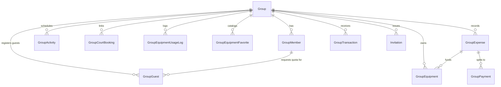
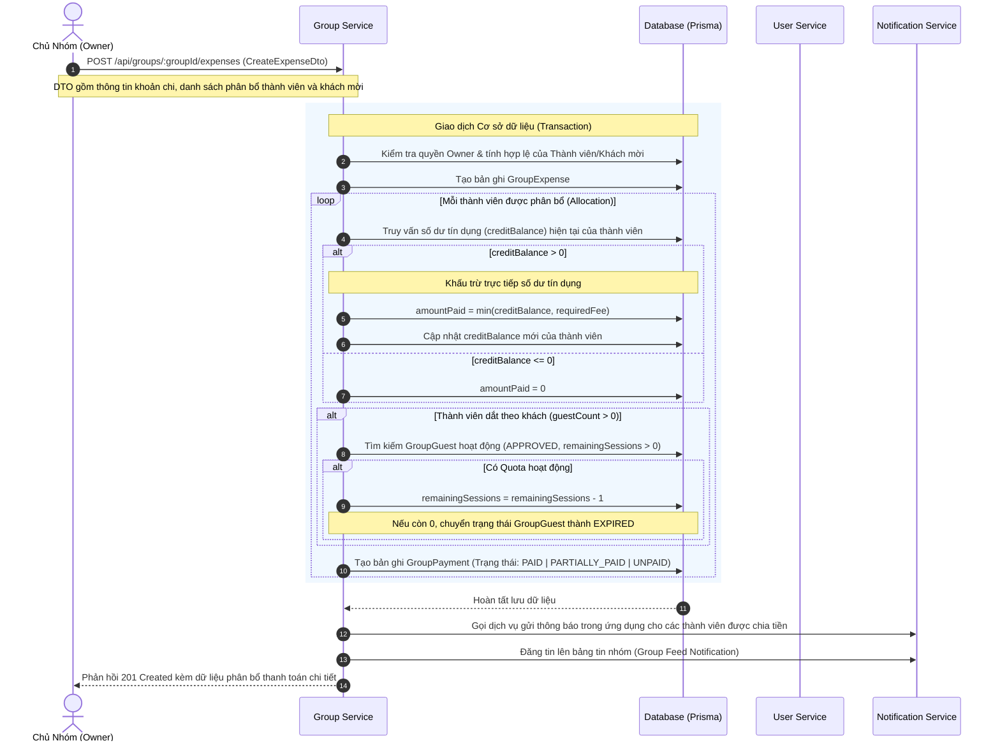
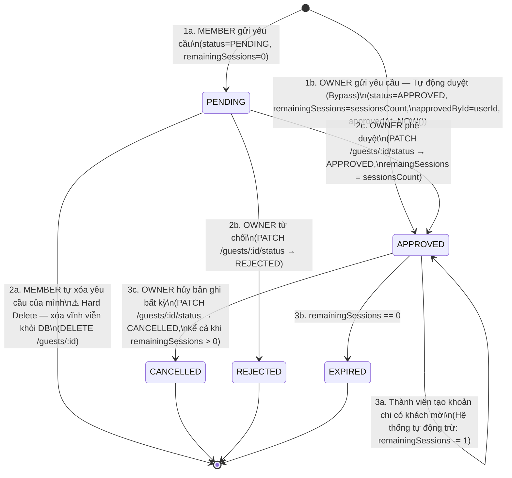

# Đặc tả Kỹ thuật: Dịch vụ Quản lý Nhóm (Group Service - `group-service`)

Tài liệu này đặc tả chi tiết kiến trúc, mô hình dữ liệu (Database Schema), các API Endpoint công khai/nội bộ và các luồng nghiệp vụ lõi (Core Business Flows) của dịch vụ quản lý nhóm (`group-service`) trong hệ thống PickleHub.

---

## 1. Tổng quan & Công nghệ Sử dụng

`group-service` chịu trách nhiệm quản lý toàn bộ vòng đời của một Câu lạc bộ / Nhóm chơi Pickleball (Group), bao gồm: thành viên nhóm, lịch hoạt động nhóm, quản lý trang thiết bị vật tư nhóm, đặt sân (liên kết từ dịch vụ đặt sân), quản lý tài chính nhóm (khoản chi, công nợ thành viên, cấn trừ số dư tín dụng) và quản lý hạn mức đăng ký người chơi vãng lai (khách mời/guests).

### Công nghệ Lõi:
*   **Framework**: [NestJS](https://nestjs.com/) (TypeScript)
*   **Database**: PostgreSQL
*   **ORM**: [Prisma Client](https://www.prisma.io/)
*   **Hàng đợi Nền (Background Jobs)**: [BullMQ](https://docs.bullmq.io/) kết hợp với Redis để xử lý nhắc nhở lịch hoạt động.
*   **API Documentation**: [Swagger/OpenAPI](https://swagger.io/) (Khởi tạo tự động tại đường dẫn `/api-docs`).
*   **Giao thức liên lạc nội bộ**: HTTP REST API bảo mật qua Token dùng chung (`x-internal-token`).

---

## 2. Thiết kế Cơ sở Dữ liệu (Prisma Schema)

Dưới đây là sơ đồ quan hệ thực thể mô tả các bảng chính trong cơ sở dữ liệu của `group-service`:

### Sơ đồ Thực thể (Entity Relationship Summary)



### Các Mô hình Dữ liệu (Database Models)

#### 1. Nhóm (`Group` - bảng `groups`)
Đại diện cho một nhóm chơi Pickleball.
*   `id`: UUID (Primary Key)
*   `name`: Tên nhóm (Tối đa 100 ký tự). Ràng buộc duy nhất trên cặp `(createdById, name)` - Một chủ sở hữu không thể tạo 2 nhóm cùng tên.
*   `description`: Mô tả nhóm.
*   `avatarUrl`: Ảnh đại diện của nhóm.
*   `maxMembers`: Số lượng thành viên tối đa (Mặc định 50).
*   `status`: Trạng thái nhóm (`ACTIVE`, `GRACE_PERIOD`, `FROZEN`, `ARCHIVED`).
*   `createdById`: ID của người tạo (UUID - OWNER).
*   `createdAt`, `updatedAt`: Thời gian khởi tạo và cập nhật.

#### 2. Thành viên Nhóm (`GroupMember` - bảng `group_members`)
Mối quan hệ nhiều-nhiều giữa User (định danh từ `user-service`) và Nhóm.
*   `id`: UUID (Primary Key)
*   `userId`: ID của User bên hệ thống Auth/User.
*   `groupId`: Liên kết tới bảng `groups`. Ràng buộc duy nhất `(userId, groupId)`.
*   `role`: Vai trò trong nhóm (`OWNER`, `MEMBER`).
*   `creditBalance`: Số dư tín dụng (Mặc định `0`). Dùng để nạp tiền trước và cấn trừ các khoản chi phát sinh.
*   `joinedAt`: Ngày gia nhập nhóm.

#### 3. Hoạt động Nhóm (`GroupActivity` - bảng `group_activities`)
Lịch chơi/lịch họp của nhóm.
*   `id`: UUID (Primary Key)
*   `groupId`: Liên kết tới nhóm.
*   `title`, `description`, `location`: Tiêu đề, mô tả, địa điểm.
*   `activityType`: Phân loại hoạt động (`PRACTICE`, `MEETUP`, `INTERNAL_MATCH`, `MEETING`, `OTHER`).
*   `startAt`, `endAt`: Thời gian bắt đầu và kết thúc.
*   `remindAt`: Thời gian gửi nhắc nhở.
*   `status`: Trạng thái hoạt động (`SCHEDULED`, `COMPLETED`, `CANCELLED`).
*   `isReminderSent`: Đã gửi thông báo nhắc nhở thành viên chưa (Boolean).
*   `createdById`: ID của người tạo lịch.

#### 4. Đặt Sân Nhóm (`GroupCourtBooking` - bảng `group_court_bookings`)
Các lượt đặt sân (từ `sport-center-service`) được chủ nhóm liên kết vào nhóm.
*   `id`: UUID (Primary Key)
*   `groupId`: Liên kết tới nhóm.
*   `title`: Tiêu đề hiển thị (ví dụ: "Đặt sân sáng Thứ Bảy").
*   `note`: Ghi chú.
*   `linkedById`: ID của người thực hiện liên kết.
*   `bookingId`: ID của đặt sân gốc trong `sport-center-service`.
*   `centerId`, `centerName`, `centerAddress`: Thông tin chi tiết trung tâm thể thao (chụp nhanh - snapshot tại thời điểm liên kết).
*   `totalBookingCost`: Tổng chi phí đặt sân (Snapshot).
*   `date`: Ngày đặt sân.
*   `startTime`, `endTime`: Thời gian bắt đầu/kết thúc phiên chơi.
*   `bookingItemsSnapshot`: Dữ liệu dạng JSON chứa thông tin chi tiết từng sân và khung giờ đặt cụ thể.

#### 5. Thiết bị Nhóm (`GroupEquipment` - bảng `group_equipment`)
Vật dụng thuộc sở hữu của nhóm (ví dụ: bóng, vợt, lưới, nước uống).
*   `id`: UUID (Primary Key)
*   `groupId`: Liên kết tới nhóm.
*   `name`: Tên thiết bị/vật phẩm.
*   `description`: Mô tả chi tiết.
*   `quantity`: Số lượng hiện có.
*   `condition`: Tình trạng vật lý (`NEW`, `GOOD`, `WORN`, `RETIRED`).
*   `purchaseCost`: Tổng chi phí mua (Không phải đơn giá).
*   `purchasedAt`: Ngày mua thiết bị.
*   `expenseId`: Liên kết tới `GroupExpense` nếu chi phí được chia đều từ quỹ/thành viên (Set null khi xóa expense).
*   `createdById`: Người ghi nhận.
*   `isFavorite`: Có được đánh dấu yêu thích làm mẫu cấu hình nhanh không.
*   `deletedAt`: Thời gian xóa tạm (Soft-delete).

#### 6. Nhật ký Sử dụng Thiết bị (`GroupEquipmentUsageLog` - bảng `group_equipment_usage_logs`)
Nhật ký ghi nhận mức độ hao phí thiết bị qua mỗi buổi chơi. Đây là bảng **chỉ-thêm (append-only)** để phục vụ kiểm toán tài sản.
*   `id`: UUID (Primary Key)
*   `groupId`: Liên kết tới nhóm.
*   `equipmentId`: Liên kết tới thiết bị.
*   `quantityUsed`: Số lượng tiêu hao (ví dụ: mất 2 quả bóng).
*   `note`: Ghi chú (ví dụ: "Bị rách trong set 2").
*   `usedAt`: Ngày sử dụng thực tế (Chủ nhóm có thể ghi lùi ngày).
*   `loggedById`: Người thực hiện ghi nhật ký.

#### 7. Mẫu Thiết bị Yêu thích (`GroupEquipmentFavorite` - bảng `group_equipment_favorites`)
Danh mục các thiết bị thường xuyên mua để làm cấu hình mẫu khi nhập mới.
*   `id`, `groupId`, `name`: Định danh. Ràng buộc duy nhất `(groupId, name)`.
*   `defaultQuantity`: Số lượng mặc định.
*   `defaultQuantityType`: Loại số lượng (`ALL` hoặc `NUMBER`).
*   `defaultCondition`: Tình trạng mặc định.
*   `defaultCost`: Tổng chi phí mặc định.
*   `usageCount`: Số lần mẫu này được tái sử dụng để tạo thiết bị thực tế.
*   `isActive`: Trạng thái hoạt động của mẫu.

#### 8. Khoản Chi tiêu Nhóm (`GroupExpense` - bảng `group_expenses`)
Ghi nhận một khoản chi cần phân bổ tài chính.
*   `id`: UUID (Primary Key)
*   `groupId`: Liên kết tới nhóm.
*   `title`, `description`: Tiêu đề và nội dung khoản chi.
*   `totalAmount`: Tổng số tiền chi.
*   `receiptUrl`: Đường dẫn ảnh hóa đơn/chứng từ.
*   `expenseDate`: Ngày phát sinh khoản chi.
*   `createdById`: Người tạo khoản chi (OWNER hoặc ADMIN).

#### 9. Yêu cầu Thanh toán của Thành viên (`GroupPayment` - bảng `group_payments`)
Nghĩa vụ tài chính cụ thể của một thành viên đối với một khoản chi (`GroupExpense`).
*   `id`: UUID (Primary Key)
*   `expenseId`: Liên kết tới `GroupExpense` (On Cascade Delete).
*   `userId`: ID của User phải đóng tiền.
*   `requiredFee`: Số tiền cần đóng.
*   `guestCount`, `guestFee`: Số lượng khách mời thành viên mang theo và phí tương ứng của khách.
*   `amountPaid`: Số tiền thực tế đã đóng.
*   `status`: Trạng thái thanh toán (`UNPAID`, `PENDING_REVIEW`, `PAID`, `PARTIALLY_PAID`, `OVERPAID`).
*   `verifiedById`: ID của Admin xác nhận thanh toán này.
*   `paidAt`: Ngày thanh toán hoàn tất.

#### 10. Giao dịch Nạp tiền (`GroupTransaction` - bảng `group_transactions`)
Yêu cầu nạp tiền/chuyển khoản minh chứng của thành viên gửi cho chủ nhóm để tăng số dư tín dụng (`creditBalance`).
*   `id`: UUID (Primary Key)
*   `groupId`, `userId`: Định danh nhóm và người chuyển khoản.
*   `amount`: Số tiền nạp.
*   `receiptUrl`: Link ảnh chụp màn hình bill chuyển khoản.
*   `status`: Trạng thái duyệt giao dịch (`PENDING_REVIEW`, `VERIFIED`, `REJECTED`).
*   `verifiedById`: ID của OWNER duyệt bill.

#### 11. Khách mời (`GroupGuest` - bảng `group_guests`)
Yêu cầu đăng ký khách mời và hạn mức tự động cho phép một thành viên dẫn khách trong số buổi nhất định mà không cần duyệt lại từng buổi.
*   `id`: UUID (Primary Key)
*   `groupId`, `memberId`: Nhóm và thành viên gửi yêu cầu.
*   `guestsCount`: Số lượng khách tối đa được mang theo mỗi buổi.
*   `sessionsCount`: Số lượng buổi chơi được áp dụng hạn mức này.
*   `remainingSessions`: Số lượng buổi chơi còn lại khả dụng (Mặc định giảm dần sau mỗi lần dùng).
*   `status`: Trạng thái yêu cầu (`PENDING`, `APPROVED`, `REJECTED`, `EXPIRED`, `CANCELLED`).
*   `approvedById`, `approvedAt`: Người và thời gian phê duyệt.
*   `note`: Ghi chú.

#### 12. Lời mời Gia nhập (`Invitation` - bảng `invitations`)
Quản lý lời mời tham gia nhóm gửi qua email.
*   `id`: UUID.
*   `inviterId`: Người gửi lời mời.
*   `targetEmail`: Email nhận lời mời.
*   `groupId`: Nhóm cần tham gia.
*   `tokenHash`: Mã băm token lời mời duy nhất dùng để kích hoạt.
*   `expiresAt`: Thời gian hết hạn (Mặc định `NOW() + 7 days`).
*   `status`: Trạng thái lời mời (`PENDING`, `ACCEPTED`, `REVOKED`).

---

## 3. Kiến trúc Phân hệ & Danh sách REST API Endpoints

Hệ thống được chia nhỏ thành các Module nghiệp vụ dưới đây. Tất cả các đường dẫn công khai bắt đầu bằng `/api/groups` đều yêu cầu xác thực JWT qua `JwtAuthGuard` (sử dụng Header `Authorization: Bearer <token>`).

### 1. Phân hệ Nhóm (Group Module)
Quản lý tạo mới, sửa đổi thông tin nhóm, quản lý danh sách thành viên và phân quyền trong nhóm.

*   `POST /api/groups`
    *   **Mô tả**: Tạo một nhóm mới. Người tạo được tự động gán quyền `OWNER`.
    *   **Quyền**: Bất kỳ người dùng đã đăng nhập.
    *   **HTTP Code**: `201 Created`
*   `GET /api/groups`
    *   **Mô tả**: Danh sách tất cả các nhóm trên hệ thống dạng phân trang (Dành cho Admin hệ thống).
*   `GET /api/groups/me`
    *   **Mô tả**: Liệt kê các nhóm mà người dùng hiện tại đang tham gia (OWNER hoặc MEMBER).
*   `GET /api/groups/:id`
    *   **Mô tả**: Lấy thông tin chi tiết một nhóm.
    *   **Quyền**: Thành viên của nhóm hoặc Admin hệ thống.
*   `PATCH /api/groups/:id`
    *   **Mô tả**: Cập nhật thông tin nhóm (Tên, mô tả, ảnh đại diện).
    *   **Quyền**: `OWNER` của nhóm.
*   `PATCH /api/groups/:groupId/archive`
    *   **Mô tả**: Lưu trữ/Đóng cửa nhóm tạm thời (Đổi trạng thái sang `ARCHIVED`).
    *   **Quyền**: `OWNER` của nhóm.
*   `POST /api/groups/:groupId/notify`
    *   **Mô tả**: Gửi thông báo trong app (In-app Notification) cho toàn bộ thành viên nhóm.
    *   **Quyền**: Thành viên nhóm.
*   `GET /api/groups/:groupId/members`
    *   **Mô tả**: Liệt kê tất cả thành viên trong nhóm kèm vai trò và thời gian gia nhập.
*   `PATCH /api/groups/:groupId/members/:memberId/role`
    *   **Mô tả**: Cập nhật vai trò thành viên (ví dụ: bổ nhiệm làm ADMIN).
    *   **Quyền**: `OWNER` của nhóm.
*   `DELETE /api/groups/:groupId/members/me`
    *   **Mô tả**: Rời khỏi nhóm một cách tự nguyện.
    *   **Ràng buộc**: `OWNER` duy nhất không thể rời nhóm trừ khi chuyển nhượng quyền.
*   `DELETE /api/groups/:groupId/members/:userId`
    *   **Mô tả**: Trục xuất (Kick) thành viên ra khỏi nhóm.
    *   **Quyền**: `OWNER` của nhóm.

### 2. Phân hệ Lịch hoạt động & Tác vụ Nền (Activity Module)
Lên lịch hoạt động và tự động nhắc nhở thành viên.

*   `POST /api/groups/:groupId/activities`
    *   **Mô tả**: Tạo một hoạt động nhóm mới.
    *   **Quyền**: `OWNER` hoặc `ADMIN` của nhóm.
*   `GET /api/groups/:groupId/activities`
    *   **Mô tả**: Lấy danh sách lịch hoạt động của nhóm (Hỗ trợ phân trang, lọc theo thời gian).
*   `GET /api/groups/:groupId/activities/:activityId`
    *   **Mô tả**: Chi tiết hoạt động.
*   `PATCH /api/groups/:groupId/activities/:activityId`
    *   **Mô tả**: Sửa lịch hoạt động.
    *   **Quyền**: `OWNER` hoặc `ADMIN` của nhóm.
*   `DELETE /api/groups/:groupId/activities/:activityId`
    *   **Mô tả**: Hủy/Xóa lịch hoạt động.

#### Luồng Tác vụ Nền (BullMQ):
*   Hệ thống sử dụng Queue tên là `activity-reminder-queue`.
*   Khi hoạt động được tạo với thời gian `remindAt` hợp lệ, một Job nhắc nhở được đưa vào hàng đợi.
*   Khi Job đến hạn chạy, `ActivityReminderProcessor` sẽ:
    1.  Kiểm tra trạng thái hoạt động có còn là `SCHEDULED` và chưa gửi nhắc nhở (`isReminderSent === false`).
    2.  Lấy danh sách ID người dùng của tất cả thành viên nhóm.
    3.  Gọi `NotificationService` để gửi thông báo đẩy trong ứng dụng.
    4.  Cập nhật trạng thái `isReminderSent = true`.

### 3. Phân hệ Khách mời (Guest Module)
Quản lý người chơi vãng lai và phê duyệt đăng ký/hạn mức dẫn khách của thành viên.

*   `POST /api/groups/:groupId/guests`
    *   **Mô tả**: Gửi yêu cầu cấp hạn mức/đăng ký dắt khách mời tự động trong các buổi tới.
    *   **Quyền**: Thành viên nhóm (`MEMBER` hoặc `OWNER`).
    *   **Logic phân nhánh theo Role khi Insert**:
        *   Nếu người gửi là `MEMBER`: Trạng thái khởi tạo `status = 'PENDING'`, `remainingSessions = 0` (chờ duyệt).
        *   Nếu người gửi là `OWNER`: **Bypass bước duyệt** — Trạng thái khởi tạo `status = 'APPROVED'`, gán luôn `remainingSessions = sessionsCount` (từ payload), ghi nhận `approvedById = request.user.userId` và `approvedAt = NOW()`.
*   `GET /api/groups/:groupId/guests`
    *   **Mô tả**: Xem danh sách yêu cầu đăng ký khách mời/hạn mức.
    *   **Logic phân quyền xem theo Role**:
        *   Lấy vai trò của `userId` (từ `request.user.userId`) trong bảng `GroupMember`.
        *   Nếu role là `OWNER`: Trả về **toàn bộ** danh sách `GroupGuest` của nhóm.
        *   Nếu role là `MEMBER`: Thêm điều kiện `WHERE memberId = request.user.userId` — chỉ trả về các bản ghi do chính thành viên đó tạo.
*   `PATCH /api/groups/:groupId/guests/:id/status`
    *   **Mô tả**: Chủ nhóm cập nhật trạng thái một yêu cầu khách mời/hạn mức.
    *   **Quyền**: `OWNER` của nhóm.
    *   **Các giá trị `status` cho phép**: `APPROVED`, `REJECTED`, `CANCELLED`.
    *   **Logic**:
        *   `APPROVED`: Gán `remainingSessions = sessionsCount`, ghi nhận `approvedById` và `approvedAt = NOW()`.
        *   `REJECTED`: Không thay đổi sessions. Bản ghi vẫn lưu trong DB.
        *   `CANCELLED`: Cho phép hủy **bất kỳ** bản ghi nào của nhóm, kể cả khi đã `APPROVED` với `remainingSessions > 0`. Bản ghi vẫn lưu trong DB với trạng thái `CANCELLED`.
*   `DELETE /api/groups/:groupId/guests/:id`
    *   **Mô tả**: Thành viên **xóa vĩnh viễn (hard delete)** yêu cầu của chính mình.
    *   **Quyền**: `MEMBER` — chỉ được xóa bản ghi do **chính mình** tạo (`memberId = request.user.userId`) và chỉ khi trạng thái đang là `PENDING`.
    *   **Hành vi**: Xóa hoàn toàn bản ghi khỏi database. Không lưu lịch sử.

### 4. Phân hệ Tài chính & Chi tiêu (Finance & Expense Module)
Quản lý tiền nong, công nợ, giao dịch nạp tiền của nhóm.

*   `POST /api/groups/:groupId/expenses`
    *   **Mô tả**: Ghi nhận một khoản chi mới của nhóm và cấu hình phân bổ tiền cho các thành viên và khách tham gia (Xem luồng nghiệp vụ chi tiết ở Mục 4).
    *   **Quyền**: `OWNER` hoặc `ADMIN` của nhóm.
*   `GET /api/groups/:groupId/expenses`
    *   **Mô tả**: Danh sách các khoản chi tiêu của nhóm.
*   `GET /api/groups/:groupId/expenses/:expenseId`
    *   **Mô tả**: Chi tiết khoản chi và phân bổ danh sách đóng tiền cụ thể của từng người.
*   `PATCH /api/groups/:groupId/expenses/:expenseId`
    *   **Mô tả**: Sửa đổi khoản chi (Chỉ có hiệu lực khi chưa có thành viên nào thực hiện đóng tiền cho khoản chi này).
*   `DELETE /api/groups/:groupId/expenses/:expenseId`
    *   **Mô tả**: Xóa khoản chi (Chỉ cho phép nếu chưa có ai thanh toán).
*   `GET /api/groups/:groupId/finances/summary`
    *   **Mô tả**: Báo cáo tài chính nhóm: Tổng chi tiêu, tổng số tiền cần thu, tổng đã thu, công nợ còn lại, số dư ròng của quỹ, và danh sách các thành viên đang có số dư tín dụng dương.
*   `GET /api/groups/:groupId/finances/credit-balances`
    *   **Mô tả**: Liệt kê các thành viên đang có tiền dư đóng thừa gửi trong nhóm (`creditBalance > 0`).
*   `GET /api/groups/:groupId/finances/debts`
    *   **Mô tả**: Thống kê danh sách thành viên đang nợ tiền nhóm kèm chi tiết các khoản chi chưa thanh toán của họ.
    *   **Quyền**: `OWNER` hoặc `ADMIN` của nhóm.
*   `GET /api/groups/:groupId/finances/me/debt`
    *   **Mô tả**: Người dùng hiện tại xem chi tiết công nợ cá nhân của mình trong nhóm.
*   `POST /api/groups/:groupId/finances/transactions`
    *   **Mô tả**: Thành viên gửi yêu cầu xác nhận đã chuyển khoản nạp tiền vào quỹ kèm ảnh minh chứng giao dịch.
    *   **Trạng thái ban đầu**: `PENDING_REVIEW`.
*   `GET /api/groups/:groupId/finances/transactions`
    *   **Mô tả**: Xem danh sách giao dịch nạp tiền để đối soát.
*   `PATCH /api/groups/:groupId/finances/transactions/:txId/verify`
    *   **Mô tả**: OWNER duyệt giao dịch chuyển tiền. Nếu duyệt thành công, hệ thống tự động cấn trừ công nợ của người này (Xem thuật toán chi tiết ở Mục 4).
    *   **Quyền**: `OWNER` của nhóm.
*   `POST /api/groups/:groupId/finances/remind`
    *   **Mô tả**: OWNER gửi thông báo in-app hoặc email nhắc nhở đóng tiền tự động đến những thành viên đang nợ.
    *   **Quyền**: `OWNER` của nhóm.
*   `POST /api/groups/:groupId/members/:memberId/refund`
    *   **Mô tả**: OWNER hoàn trả lại tiền mặt/chuyển khoản ngoài hệ thống cho thành viên có số dư đóng thừa và ghi nhận giảm số dư tín dụng tương ứng trên hệ thống.
    *   **Quyền**: `OWNER` của nhóm.

### 5. Phân hệ Liên kết Đặt sân (Court Booking Module)
Tích hợp lịch thi đấu và thông tin sân từ `sport-center-service`.

*   `POST /api/groups/:groupId/court-bookings`
    *   **Mô tả**: Liên kết một mã đặt sân đã thanh toán/xác nhận từ tài khoản cá nhân của chủ nhóm sang nhóm chơi.
    *   **Quyền**: `OWNER` của nhóm.
*   `GET /api/groups/:groupId/court-bookings`
    *   **Mô tả**: Lấy danh sách các lượt đặt sân đã liên kết vào nhóm.
*   `GET /api/groups/:groupId/court-bookings/:id`
    *   **Mô tả**: Xem chi tiết sân đặt kèm thông tin thời gian thực (Live Check) từ trung tâm thể thao.
*   `DELETE /api/groups/:groupId/court-bookings/:id`
    *   **Mô tả**: Hủy liên kết đặt sân ra khỏi nhóm (Không hủy đặt sân thực tế ở dịch vụ đặt sân).
    *   **Quyền**: `OWNER` của nhóm.

### 6. Phân hệ Lời mời & Thành viên ngoài (Invitation Module)
Mời người chơi tham gia nhóm qua thư điện tử hoặc mã liên kết.

*   `POST /api/groups/:groupId/invitations`
    *   **Mô tả**: Tạo thư mời gửi đến email người nhận. Hệ thống băm mã token và tạo liên kết xác thực gửi đi.
*   `GET /api/groups/:groupId/invitations`
    *   **Mô tả**: Danh sách các thư mời đang chờ chấp nhận.
*   `DELETE /api/groups/:groupId/invitations/:invitationId`
    *   **Mô tả**: Thu hồi thư mời đã gửi.

---

## 4. Các Luồng Nghiệp vụ Lõi (Core Business Flows)

### Luồng 1: Tạo khoản chi (`GroupExpense`) & Phân bổ Công nợ

Khi chủ nhóm hoặc ban quản trị tạo một khoản chi tiêu (ví dụ: mua bóng, thuê sân) và cấu hình phân chia tiền:



---

### Luồng 2: Thuật toán Duyệt giao dịch & Tự động cấn trừ công nợ theo FIFO

Khi một thành viên chuyển khoản đóng tiền, họ tải minh chứng giao dịch lên hệ thống. Khi chủ nhóm nhấn phê duyệt giao dịch (`VERIFIED`), hệ thống tự động cấn trừ tiền nợ theo nguyên tắc **FIFO (Vào trước, Xuất trước - Khoản nợ cũ được trả trước)**:

```mermaid
flowchart TD
    Start([1. Chủ nhóm duyệt giao dịch: STATUS = VERIFIED]) --> DB_UpdateTx[2. Cập nhật trạng thái giao dịch trong DB sang VERIFIED]
    DB_UpdateTx --> DB_GetMember[3. Lấy thông tin thành viên & số dư tín dụng hiện tại]
    
    DB_GetMember --> Calc_Available[4. Tính tổng số tiền khả dụng: <br/><b>totalAvailable = amount_giao_dịch + creditBalance_hiện_tại</b>]
    
    Calc_Available --> Fetch_MemberDebts[5. Lấy danh sách GroupPayment chưa trả hết của thành viên <br/><i>(Sắp xếp tăng dần theo ngày tạo - Cũ nhất lên đầu)</i>]
    
    Fetch_MemberDebts --> Loop_Start{6. Duyệt qua từng khoản nợ trong danh sách}
    
    Loop_Start -- Còn nợ & totalAvailable > 0 --> CheckDebt{7. Khoản nợ hiện tại: <br/><b>currentDebt = requiredFee - amountPaid</b>}
    CheckDebt -- currentDebt > 0 --> Allocate[8. Tính toán tiền trả: <br/><b>deduction = min(totalAvailable, currentDebt)</b>]
    Allocate --> ApplyPay[9. Cập nhật số tiền đã trả cho khoản nợ: <br/><b>amountPaid = amountPaid + deduction</b>]
    ApplyPay --> UpdateStatus[10. Cập nhật trạng thái khoản nợ: <br/>Nếu trả đủ thì trạng thái = PAID, ngược lại = PARTIALLY_PAID]
    ApplyPay --> DeductAvailable[11. Khấu trừ quỹ khả dụng: <br/><b>totalAvailable = totalAvailable - deduction</b>]
    ApplyPay --> Loop_Start
    
    CheckDebt -- currentDebt <= 0 --> Loop_Start
    
    Loop_Start -- Hết danh sách nợ HOẶC totalAvailable = 0 --> SaveRemaining[12. Lưu số tiền còn dư lại vào số dư tín dụng: <br/><b>creditBalance = totalAvailable</b>]
    SaveRemaining --> SendNotify[13. Gửi thông báo In-app thông báo thành viên đóng tiền thành công]
    SendNotify --> End([Hoàn thành])
```

---

### Luồng 3: Vòng đời đăng ký Khách mời (GroupGuest Lifecycle)



---

### Luồng 4: Quy trình liên kết và đồng bộ Đặt sân (Court Booking Linkage)

Chủ nhóm có thể liên kết sân đấu của mình từ dịch vụ đặt sân sang nhóm chơi để chia sẻ thông tin.

1.  **Hiển thị dropdown chọn sân chơi (Frontend Flow)**:
    *   Ứng dụng gọi API `GET /bookings/me` bên dịch vụ sân đấu (`sport-center-service`).
    *   Lọc ra các giao dịch đặt sân có trạng thái `CONFIRMED` hoặc `COMPLETED`.
    *   Nhãn hiển thị dropdown được dựng từ thông tin trung tâm thể thao và ngày đặt, dạng: `"{Tên sân trung tâm} - {Ngày đặt dạng DD/MM/YYYY}"`.
2.  **Liên kết (Link)**:
    *   Khi chọn một sân đấu, gửi ID của đặt sân đó qua API `POST /api/groups/:groupId/court-bookings`.
    *   Hệ thống kiểm tra quyền, gọi API nội bộ sang `sport-center-service` xác thực chủ sở hữu đặt sân và ghi nhận một bản sao snapshot tĩnh (`bookingItemsSnapshot`) để tối ưu hiệu năng hiển thị danh sách.
3.  **Xem chi tiết thời gian thực (Live Check)**:
    *   Để tránh tải nặng cho hệ thống, khi xem danh sách đặt sân của nhóm chơi, hệ thống chỉ trả về snapshot tĩnh đã lưu.
    *   Chỉ khi người dùng nhấn vào xem chi tiết một đặt sân cụ thể (`GET /:id`), hệ thống mới thực hiện một cuộc gọi REST đồng bộ sang `sport-center-service` để kiểm tra trạng thái trực tiếp của đặt sân hiện tại (ví dụ: sân có bị hủy hay đổi giờ phút chót không). Nếu dịch vụ đặt sân bị gián đoạn, hệ thống trả về `null` cho trường live và hiển thị dữ liệu snapshot tĩnh để ứng dụng hoạt động bình thường (Graceful Degradation).

---

## 5. Xác thực & Giao tiếp Liên dịch vụ (Authentication & Security)

Hệ thống triển khai 3 lớp bảo vệ để kiểm soát truy cập và xác thực danh tính:

### 1. Xác thực bằng mã JWT nội bộ (`JwtAuthGuard`)
*   Sử dụng thư viện `jsonwebtoken` để giải mã và xác thực trực tiếp Access Token được truyền vào từ Header `Authorization: Bearer <token>`.
*   Sử dụng khóa bí mật cấu hình qua biến môi trường `JWT_ACCESS_SECRET`.
*   Sau khi giải mã thành công, thông tin người dùng được gán trực tiếp vào Request Context:
    ```typescript
    request.user = {
      userId: payload.sub || payload.userId,
      email: payload.email,
      roles: Array.isArray(payload.role) ? payload.role : [payload.role]
    };
    ```

### 2. Xác thực ủy nhiệm qua Dịch vụ xác thực (`AuthProxyGuard`)
*   Dành cho một số phân hệ cần cập nhật thông tin người dùng theo thời gian thực hoặc kiểm tra trạng thái khóa tài khoản.
*   Guard thực hiện chuyển tiếp mã JWT qua một cuộc gọi HTTP đồng bộ tới API `/api/auth/me` của dịch vụ `auth-service` (Định nghĩa qua biến `AUTH_SERVICE_URL`).
*   Nếu kết quả trả về là `200 OK`, danh tính người dùng được chấp nhận và lưu thông tin vào request context.

### 3. Bảo mật giao tiếp giữa các Microservices (`x-internal-token`)
*   Các API nội bộ phục vụ cho việc đồng bộ dữ liệu chéo giữa các service (Ví dụ: Thư mời gia nhập nhóm được gọi từ Auth Service khi người dùng bấm liên kết đăng ký tài khoản mới) được bảo vệ bằng Header đặc biệt: `x-internal-token`.
*   Mã token này được kiểm tra nghiêm ngặt với giá trị cấu hình trong file biến môi trường (`GROUP_INTERNAL_TOKEN` hoặc `AUTH_INTERNAL_TOKEN`). Nếu token không khớp, hệ thống ném lỗi `403 Forbidden` ngay lập tức.

---

## 6. Xử lý Lỗi & Mã lỗi Chuẩn hóa (Error Handling)

`group-service` định nghĩa bộ mã lỗi chuẩn hóa để trả về cho Client khi có lỗi nghiệp vụ xảy ra. Định dạng phản hồi lỗi:

```json
{
  "statusCode": 400,
  "message": "Thông báo lỗi chi tiết",
  "error": "Tên lỗi HTTP"
}
```

Các mã lỗi nghiệp vụ được lưu trữ tập trung tại lớp `GroupErrors`:

| Mã Lỗi (Error Code) | HTTP Status | Thông điệp lỗi mặc định | Mô tả ngữ cảnh |
| :--- | :--- | :--- | :--- |
| `GROUP_NOT_FOUND` | `404 Not Found` | Group not found. | Nhóm không tồn tại trên hệ thống. |
| `GROUP_NOT_MEMBER` | `403 Forbidden` | You are not a member of this group. | Người dùng yêu cầu thông tin không thuộc nhóm chơi này. |
| `GROUP_NOT_OWNER` | `403 Forbidden` | Only the group owner can perform this action. | Thao tác quản trị (như đổi tên nhóm, duyệt tiền) chỉ dành cho OWNER. |
| `GROUP_STATUS_NOT_EDITABLE` | `400 Bad Request` | Group can only be updated when status is ACTIVE or GRACE_PERIOD. | Nhóm đã bị đóng băng hoặc lưu trữ, không thể chỉnh sửa. |
| `GROUP_MEMBER_NOT_FOUND` | `404 Not Found` | Member not found in this group. | ID thành viên đích không tồn tại trong danh sách thành viên nhóm. |
| `GROUP_CANNOT_CHANGE_OWNER_ROLE` | `400 Bad Request` | The owner's role cannot be changed. | Không cho phép hạ quyền OWNER xuống thành viên thường. |
| `GROUP_INVALID_ROLE` | `400 Bad Request` | Role must be MEMBER. | Vai trò gán không hợp lệ ngoài danh mục quy định. |
| `GROUP_CANNOT_KICK_OWNER` | `403 Forbidden` | The group owner cannot be removed. | Không thể trục xuất chủ sở hữu nhóm ra khỏi nhóm. |
| `GROUP_OWNER_CANNOT_LEAVE` | `403 Forbidden` | You are the only owner. Transfer ownership before leaving. | Chủ nhóm duy nhất muốn rời nhóm phải chuyển nhượng quyền Owner cho người khác trước. |
